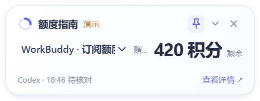
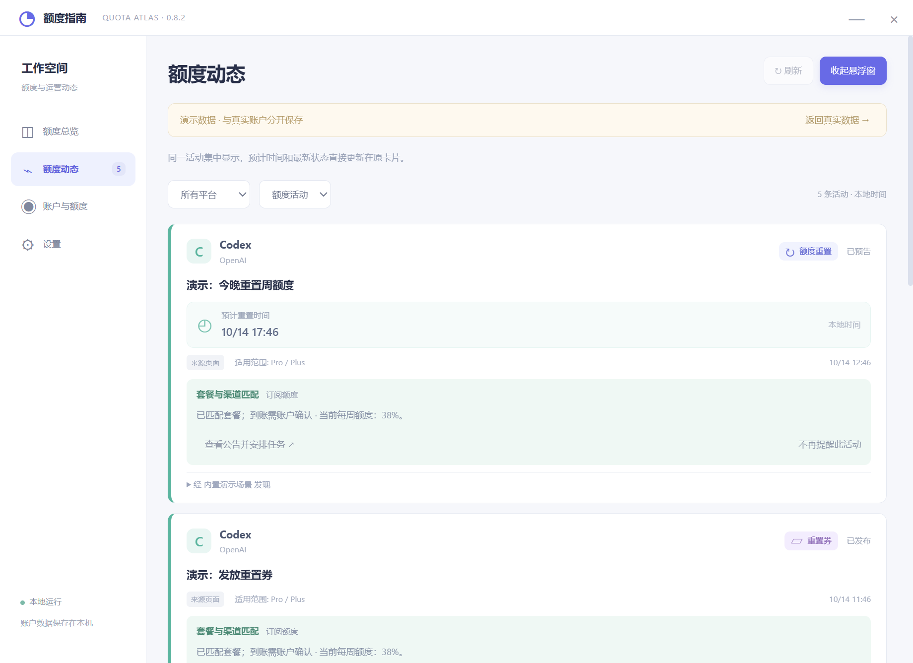

# Quota Atlas

[简体中文](README.zh-CN.md) · Windows 10/11 x64 · Early beta · MIT

A desktop companion for AI service quotas and reset or credit announcements.
See known quota, understand whether an announcement may apply to your account,
and find the time and action that matter. Percentages, credits, currency and
subscription/API accounts remain separate.





All screenshots use built-in demo data. They are not provider announcements.

## What works, and what is experimental

| Connection | Verification status | Important limits |
| --- | --- | --- |
| Codex local quota | Real account tested on the development computer | Requires an installed, signed-in client; version compatibility varies |
| WorkBuddy local credits | Real account tested on the development computer | Requires a compatible running Windows client; package expiry may be unavailable |
| Claude local/web subscription | Experimental; fixture tests | Real official subscription authorization remains unverified |
| DeepSeek, Gemini, Grok API | Experimental; fixture tests | Real-account authorization remains unverified; different credentials and permissions apply |
| DeepSeek, Gemini, Grok web usage | Experimental page observation | Only explicitly labelled values; provider page changes can break extraction |
| Public announcements | Official pages, rules and community feeds | Coverage is incomplete; access failures and uncertainty are shown |
| Optional public X accounts | Adapter tested with fixtures | Requires your own X API access; real authorization and any charges are your responsibility |
| Windows notifications | Controlled test received a native display receipt, appeared in notification history, and its banner was confirmed by the tester | Real click navigation and live-campaign end-to-end delivery remain unverified; display depends on Windows settings |

Supported UI languages: Simplified Chinese, English, Japanese and Korean.
Original announcements retain their original language. Unknown quota stays unknown.

## Download and use

Open this repository's **Releases** section and choose a Windows x64 **pre-release**,
if one has been published. GitHub's automatically generated source archive is not
the ready-to-run desktop package.

1. Download `QuotaAtlas-<version>-windows-x64.zip` and its `.sha256` file.
2. Compare the ZIP hash with a checksum from a trusted source, then extract everything.
3. Run `install.cmd`, then open Quota Atlas from the Start menu.
4. Open Settings to choose a language, primary widget account and alert preferences.
5. Use **Send test notification** to check your notification setup.

This beta is unsigned. Hashes check integrity and do not replace code signing.
Installed data is separate from program files. Updates use the new package's
`update.cmd`; `uninstall.cmd` from an installed copy removes program versions and
preserves account data. There is no online auto-updater.

## Run from source

Use **Windows x64**, Node.js 24 LTS, Git and npm (the lockfile was generated with npm 10.9.4).

```sh
npm ci
npm run setup
npm run demo
```

Setup downloads the pinned Electron archive from its official GitHub release,
verifies its SHA-256 from `config/runtime.json`, and extracts it into `.cache`.
The first setup needs network access. Demo uses a separate profile, synthetic data,
no background provider polling and no OS notifications.

For actual local use, run `npm start`. That mode can discover an existing Codex login
and reads enabled connections. Keep `.local` and `.cache` private.

```sh
npm run check
npm test
npm run test:desktop
npm run test:installer
npm run build
npm run verify:package
npm run test:package
npm run release:source
```

`check` and unit tests can also run on Linux. Desktop, installer and packaging commands
require Windows x64. Installer tests operate in isolated directories with fake executable
fixtures, do not launch them, and create no Start menu or startup entry.
Build output is in `dist/`; existing archives are never silently overwritten.

See [development](docs/DEVELOPMENT.md), [connections](docs/CONNECTIONS.md),
[privacy](PRIVACY.txt), [security reporting](SECURITY.md), and
[release checklist](docs/RELEASING.md).

## How announcements are handled

- A card distinguishes automatic resets, credit grants, reset vouchers and claims.
- Known times, deadlines, plans, channels and source links stay with the event.
- Identified follow-up stages update the same card; uncertain identity stays separate.
- Historical activity is quiet on first launch. Uncertain eligibility remains explicit.
- An observed balance increase is not proof that a campaign caused it.
- App quit, sleep, inaccessible sources and upstream delays affect discovery.

## Current beta limits

The last development-network check could not read some OpenAI, Gemini and xAI official
announcement endpoints. This is an access failure, not proof that no activity exists.
Rules-based interpretation can miss special wording. The app does not predict
unannounced resets or guarantee coverage, applicability or delivery.

Independent-machine onboarding, additional real provider accounts, physical network
loss, overnight sleep and longer reliability trials remain outstanding. CI uses
synthetic data and does not establish those real-world results.

## Feedback and license

Use Issues for reproducible bugs and feature requests. Include app/Windows versions
and steps, not credentials, cookies, raw authenticated responses or whole data folders.
Use [private security reporting instructions](SECURITY.md) for sensitive issues.

Project source: [MIT](LICENSE). Third-party components retain their
[own licenses and notices](THIRD_PARTY_NOTICES.txt). Quota Atlas is an independent
project; it is not affiliated with or endorsed by the monitored providers.
